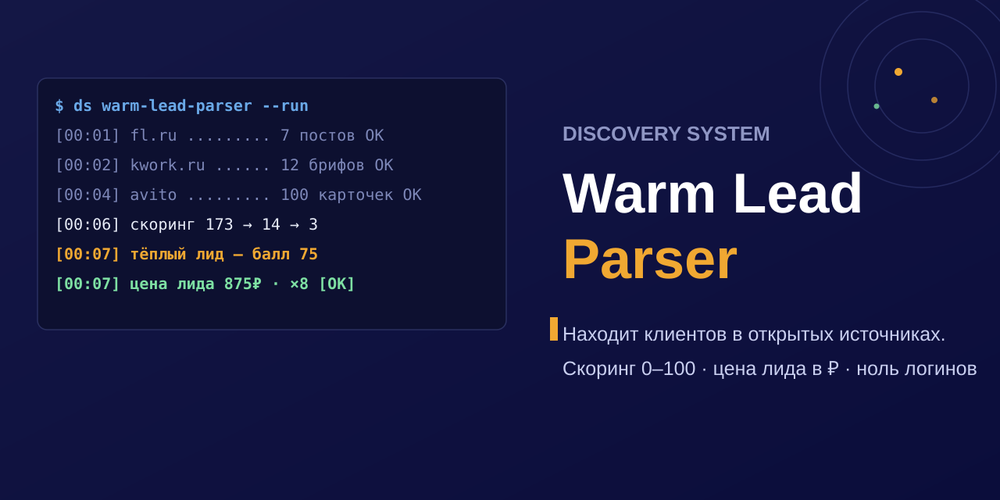

# ds_warm-lead-parser

**Discovery Warm Lead Parser**

<div align="center">

</div>

<div align="center">

**Находит клиентов в открытых источниках и говорит, с кем связаться первым.**

`[00:20] 53 ниши · 57 телеграм-каналов + 7 бирж + Авито → 4400 постов → 590 в нише → 🔥 49 + 💰 цена лида`


</div>

> **Warm Lead Parser не спамит и не «парсит всё».** Читает только открытые публичные ленты, оценивает каждый пост по готовности платить и отдаёт короткий список: с кем связаться сегодня и почему. Каждый отчёт считает цену тёплого лида в ₽.

---

## Установка и использование

Скилл ставится копированием папки (или `SKILL.md`) в `.claude/skills/` / `.hermes/skills/` — и живёт под именем **`ds_warm-lead-parser`**. В чате агенту достаточно сказать: «запусти ds_warm-lead-parser для …» — имя уникально и не конфликтует с чужими скиллами.

```bash
# вариант 1 — клон репо целиком
git clone https://github.com/r0undm1dn1ghty-star/ds_warm-lead-parser.git && cp -r discovery-warm-lead-parser/.claude/skills/* ~/.claude/skills/ 2>/dev/null || cp discovery-warm-lead-parser/SKILL.md ~/.claude/skills/ds_warm-lead-parser/SKILL.md

# вариант 2 — только SKILL.md (у кого он есть в корне)
cp discovery-warm-lead-parser/SKILL.md ~/.claude/skills/ds_warm-lead-parser/SKILL.md
```

Все скиллы Discovery System — с префиксом **`ds_`**: `ds_pnl-check`, `ds_spiral-maturity`, `ds_geo-audit`, `ds_market-evidence`, `ds_warm-lead-parser`, `ds_content-radar`. Комплект и связка — [discovery-system.ru](https://discovery-system.ru).

## Зачем это бизнесу

Вы продаёте услуги или внедрения — а ваши будущие клиенты прямо сейчас пишут «нужен бот», «срочно доделать», «внедрить ИИ», «нарисовать арт», «нужен репетитор» на биржах и в чатах. Пока вы не видите эти посты — их разбирает кто-то другой, часто в тот же день.

Warm Lead Parser закрывает этот разрыв за один прогон — в **53 преднастроенных нишах**: от ИИ-агентов и чат-ботов до копирайтинга, дизайна, SEO, репетиторства и инженерных чертежей. Своя ниша добавляется в конфиг за минуту.

| Шаг | Что происходит | Результат |
|---|---|---|
| **1. Собрать** | Движок читает 64 источника: 57 телеграм-каналов (заказы/биржи), 7 веб-бирж (FL.ru, Weblancer, Kwork, Kadrof, searchengine.guru, illustrators.ru, poisk-pro) и Авито (опционально, стелс). Каждый источник проверяется на живость при прогоне: не ответил — пропускается, не роняя бюджет. | Тысячи постов с датами, ценами, ссылками. |
| **2. Оценить** | Каждый пост получает балл готовности 0–100: точная ли тема, названы ли деньги, есть ли срочность и ТЗ. Вакансии-наёмка и резюме соискателей отсеиваются. | Отсортированный список с объяснением каждого балла. |
| **3. Решить** | 🔥 связаться сегодня → 🌤 мягкий заход → 📊 рыночные сигналы Авито (цены конкурентов). | Приоритет + экономика: цена тёплого лида в ₽. |
| **3.5 Схлопнуть** | Один заказ часто висит на бирже, в RSS и в трёх Telegram-каналах. Движок оставляет один лид и помнит остальные площадки. | Одно обращение вместо четырёх копий |
| **4. Проверить** | Флаг `--enrich`: по тексту поста парсер достаёт ИНН/название и добирает бизнес из открытых госреестров. | Кто за объявлением: отрасль, размер, живость, ФИО руководителя, email. |

### Кто стоит за объявлением — флаг `--enrich`

Объявление анонимно: «нужен бот для учёта, бюджет 50 тыс». Кто пишет — непонятно: живая компания или однодневка, которая не заплатит?

`--enrich` добирает это из открытых госисточников — **без ключей, регистраций и оплаты**:

| Источник | Что даёт |
|---|---|
| **ЕГРЮЛ** | юрлицо, ИНН/ОГРН/КПП, дата регистрации, регион, **руководитель с должностью**, дата прекращения деятельности |
| **Реестр МСП** | категория (микро / малое / среднее), **отрасль по ОКВЭД**, город, лицензии, госконтракты |
| **«Работа России»** | жив ли бизнес прямо сейчас, сколько активных вакансий, **email работодателя** |

```bash
python warm_lead_parser.py ai-agents --enrich-top=3   # обогатить топ-3 тёплых лида
```

В отчёте появляется блок **«🏢 Кто за объявлением»** — под каждым лидом карточка бизнеса.

Живой прогон 24.10.2026: пост в Telegram-канале → **ООО «ЭДЮСОН»**, дополнительное образование, Москва, с 2014 года, генеральный директор — Новожилова Кристина Игоревна. Всё из открытых реестров, без единого API-ключа.

Модуль работает и отдельной командой — например, если у вас есть только ИНН из переписки:

```bash
python integrations/enrich.py --inn 7707083893         # по ИНН
python integrations/enrich.py --name "Мастер-Ювелир"   # по названию
python integrations/enrich.py --text "Нужен бот, ИНН 7707083893, бюджет 50 тыс"  # якоря найдёт сам
python integrations/enrich.py --selftest               # 10 проверок без сети
```

## Быстрый старт (2 минуты)

1. Убедитесь, что установлен [Python 3.10+](https://www.python.org/downloads/) (стандартная библиотека, без зависимостей).
2. Скачайте [`warm_lead_parser.py`](warm_lead_parser.py) и [`niches-50.json`](niches-50.json) в одну папку.
3. Посмотрите список ниш и запустите — все или одну:
   ```bash
   python warm_lead_parser.py --list        # 53 ниши
   python warm_lead_parser.py               # все ниши
   python warm_lead_parser.py chatbots      # одна ниша, полный режим
   ```
4. Откройте `warm-lead-report-<дата>.md`: таблица ниш, тёплые лиды с ссылками и объяснением баллов, экономика прогона.

**Не хотите терминал?** Откройте `warm_lead_parser.py` в любом ИИ-агенте (Claude, ChatGPT, Gemini, локальный агент) и скажите: «разберись и запусти». Файл самодокументирован.

**Авито (опционально):** требуется стелс-браузер Camoufox — установка одной командой, детали в [`avito/README.md`](avito/README.md). Без него парсер работает на всех остальных источниках и честно пишет «пропускаю».

## Проверка на реальных рыночных данных

Скилл прогнан на реальных данных рынка — не на синтетике. Полный разбор с
цифрами, покрытием и воспроизводимыми командами: **[EVAL.md](EVAL.md)**.

Бенчмарк против наивного метода на реальных данных: **[BENCHMARK.md](BENCHMARK.md)**.

## Что внутри

| Путь | Содержимое |
|---|---|
| [`warm_lead_parser.py`](warm_lead_parser.py) | Движок: сбор + скоринг + экономика. Один файл, stdlib-only. |
| [`integrations/enrich.py`](integrations/enrich.py) | Обогащение по открытым госисточникам (ЕГРЮЛ, реестр МСП, «Работа России») — без ключей. |
| [`integrations/sources.py`](integrations/sources.py) | Правила скоринга и анти-HR фильтра как отдельный модуль (для MCP и своих сборок). |
| [`integrations/mcp_server.py`](integrations/mcp_server.py) | MCP-сервер: скоринг лидов для любого LLM-клиента по stdio. |
| [`niches-50.json`](niches-50.json) | 53 ниши: ключи, источники, запросы. Правится текстом. |
| [`avito/`](avito/) | Авито-сборщик на Camoufox (опциональный источник). |
| [`examples/`](examples/) | рыночные прогоны на живых источниках: [`competition-2026-09-20.md`](examples/competition-2026-09-20.md). |
| [`assets/`](assets/) | Логотип и баннер (INDIGO TERMINAL). |
| [`reports/`](reports/) | Реальные отчёты прогонов. |
| [`docs/ru/`](docs/ru/) | Источники, скоринг, экономика, риски FL. |
| [`docs/en/`](docs/en/) | English summary. |
| [`SAFETY_RAILS.md`](SAFETY_RAILS.md) | Этика и границы. |
| [`CHANGELOG.md`](CHANGELOG.md), [`LICENSE`](LICENSE) | История, MIT. |

## Чего НЕ делает

| Не делает | Почему |
|---|---|
| Не собирает телефоны/email массово, не рассылает | Спам-инструментация, забанят домен; работаем с публичными постами «ищу исполнителя» |
| Не логинится, не решает капчи, не сканирует приватные группы | Легальный периметр: публичный поиск как руками |
| Не обещает «100500 лидов в час» | Честная скорость: ~35 секунд на нишу при живых источниках; потолок ожидания любого сокета — 12 секунд с версии 2.3 |
| Не заменяет продажи | Парсер — первая линия; продаёте вы |

## Проект Discovery System

Warm Lead Parser — бесплатный инструмент [Discovery System](https://r0undm1dn1ghty-star.github.io/discovery-system/): рыночная разведка в мире ИИ-агентов. Калькулятор стоимости рутины, гайд связок, разборы с источниками — на [лендинге](https://r0undm1dn1ghty-star.github.io/discovery-system/).

## Кто это сделал

Инструмент открытый и бесплатный — и останется таким: **ценность создаётся самим инструментом, а не замком на нём.** Копируйте, форкайте, используйте в своей работе.

Что помогает автору — Telegram-канал с разборами, обновлениями и приёмами поиска заказов: **[t.me/discoverysystem](https://t.me/discoverysystem)**. Там же быстрее отвечают на вопросы по настройке, а новые версии выходят раньше, чем попадают в этот репозиторий.

Если инструмент сэкономил вам время — лучшая благодарность не звёздочка, а рассказ о нём тому, у кого та же задача.

## Лицензия

MIT — свободно, с атрибуцией. Границы — в [`SAFETY_RAILS.md`](SAFETY_RAILS.md).

## English summary

**Discovery Warm Lead Parser** — open-source tool that finds buyers in public sources (57 Telegram job boards via t.me/s/, FL.ru, Weblancer, Kwork, Kadrof, poisk-pro.ru, searchengines.guru, illustrators.ru, Avito via stealth browser) and ranks them 0–100 by readiness-to-pay across 53 pre-configured niches. Economics in every run (cost per warm lead), no logins, no spam, resume-posts filtered out. One Python file, stdlib-only, works with any AI agent. Russian is authoritative — see [`docs/en/`](docs/en/).

---

<script type="application/ld+json">
{
  "@context": "https://schema.org",
  "@type": "SoftwareApplication",
  "name": "Discovery Warm Lead Parser",
  "applicationCategory": "BusinessApplication",
  "operatingSystem": "Windows, macOS, Linux",
  "description": "Open-source инструмент поиска тёплых лидов в открытых источниках (57 телеграм-каналов, FL.ru, Weblancer, Kwork, Kadrof, poisk-pro, searchengines.guru, illustrators.ru, Авито) со скорингом готовности 0-100 в 53 нишах и экономикой каждого прогона.",
  "offers": {"@type": "Offer", "price": "0", "priceCurrency": "RUB"},
  "author": {"@type": "Organization", "name": "Discovery System"},
  "programmingLanguage": "Python",
  "license": "https://opensource.org/licenses/MIT",
  "featureList": ["53 ниши из коробки", "Скоринг 0-100 с объяснением", "Экономика лида в каждом отчёте", "Без логинов и API-ключей", "Конфиг правится текстом"],
  "audience": {"@type": "Audience", "audienceType": "предприниматели, фрилансеры, агентства, ИИ-агенты"}
}
</script>

## Скоринг: 0-100

| Сигнал | Баллы |
|---|---|
| Точное попадание в нишу (формулировки ниши из конфига) | +40 |
| Смежная тема (слова ниши) | +15 |
| Названы деньги (бюджет, оплата, ₽) | +25 |
| Срочность | +15 |
| Готов к контакту (ТЗ, «в ЛС») | +10 |
| Бюджет в коридоре 1К–600К ₽ | +10 |
| Свежесть <24ч / <72ч | +10 / +5 |
| Пост старше 17 дней | −15 |
| #резюме / «ищу работу» | 0 — соискатель, не клиент |

**🔥 60+** связаться сегодня · **🌤 40–59** мягкий заход · ниже — мимо.

## Roadmap

- [x] v1.0 — 6 площадок (FL.ru, Kwork, Freelance.ru, Weblancer, Telegram, Авито), скоринг 0–100, экономика
- [x] v1.1 — 100 источников: 76 ТГ-каналов (t.me/s/) + 23 веб-биржи + Авито-стелс; hiring-фильтр вакансий; красные флаги (rescue/lowball/tos-risk)
- [x] v2.0 — мульти-ниша: 53 ниши в конфиге, скоринг по ключам ниши, запуск всех ниш одним прогоном
- [x] v2.1 — третья волна фактчека: пул живых ТГ-каналов пересобран, +Kadrof (заказы с датами и бюджетами), фильтр #резюме (соискатели ≠ клиенты)
- [x] v2.2 — +3 специализированные биржи: poisk-pro.ru (инженерия/чертежи, заказы 20–233К ₽), searchengines.guru (SEO/контекст/таргет), illustrators.ru (графика 2D/3D)
- [x] v2.3 — жёсткий потолок ожидания сокета (`socket.setdefaulttimeout(12)`): один зависший источник (FL.ru) больше не сжирает бюджет прогона; исправлен бенчмарк скорости в README на честный «~35 секунд на нишу при живых источниках»
- [x] v2.5 — мульти-источниковый бенчмарк: 6 площадок, 110 карточек с ручной разметкой; морфологический матчинг ключей
- [x] v2.6 — обогащение по открытым госисточникам: ЕГРЮЛ + реестр МСП + «Работа России» (отрасль, размер, живость, руководитель, email) — без ключей и регистраций
- [x] v2.7 — FL.ru переведён на официальную RSS-ленту (60 заказов с текстами одним запросом вместо падающего HTML) + схлопывание дублей между площадками
- [x] v2.8 — контакты из поста прямо в лиде (почта, телефон, @ник, домен)
- [x] v2.9 — правила с приоритетами (Exclude/Penalty/Boost, 4 типа сопоставления) + история прогонов: отчёт помечает новое и повторы
- [ ] v2.7 — автопилот: cron-прогон, дайджест в Telegram
- [ ] v2.8 — ИИ-агент пишет черновики откликов

